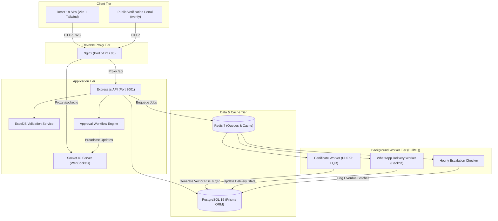

# CertiFlow — Trust-First Skilling Certificate Issuance Platform

> **Fictional Government Programme:** Pragati Skills Mission (PSM)  
> **Target Scale:** ~8,000 candidates/month across 300+ private training centres in 36 districts.

---

## 1. Project Title
**CertiFlow: Centralized, Tamper-Evident Skilling Certificate Issuance & Public Verification Platform.**

---

## 2. Requirements Note
This project was implemented as an individual hackathon submission following the strict mandatory technology stack:
- **Frontend**: React 18, Vite, TypeScript, Tailwind CSS, React Router v6.
- **Backend**: Node.js 20, Express.js 5, TypeScript.
- **Database & ORM**: PostgreSQL 15, Prisma ORM with proper migrations.
- **Caching & Queues**: Redis 7, BullMQ event-driven background workers.
- **Libraries**: PDFKit (landscape A4 vector PDFs), qrcode (dynamic verification QR codes), Multer, ExcelJS (spreadsheet processing), Zod (schema validation), Socket.IO (real-time updates), Vitest (automated testing).
- **Containerization**: Docker, Docker Compose multi-service architecture.

No alternative backend-as-a-service providers (Firebase, Supabase, MongoDB) were used.

---

## 3. Problem Statement
The Pragati Skills Mission currently faces critical operational challenges:
- Private training centres submit candidate batches via unstandardized Excel spreadsheets over email.
- District officers communicate informal candidate approvals via WhatsApp without centralized records.
- Certificates are manually created in Microsoft Word, resulting in multi-week delivery lags.
- Fraudulent and modified certificates circulate without a trusted verification mechanism.
- Employers have no digital channel to authenticate credentials.
- Inactive batches linger on officer desks for weeks without escalation or deadline tracking.

---

## 4. Proposed Solution
**CertiFlow** delivers a unified, auditable digital platform:
1. **Intelligent Batch Upload**: Training centres upload candidate spreadsheets with atomic validation.
2. **Multi-Level Approval Pipeline**: Enforces approval from **two distinct district officers**, quality team scrutiny for large batches (>50 candidates), and final state office sign-off.
3. **Automated Vector PDF Issuance**: Generates professional A4 certificates with tamper-evident QR codes and unique IDs (`PSM-YYYY-XXXXXXXX`).
4. **Decoupled Background Processing**: Asynchronous PDF rendering and WhatsApp delivery simulation via BullMQ workers with exponential backoff.
5. **Zero-Login Public Verification**: Employers and citizens verify validity (`VALID`, `CANCELLED`, `INVALID`) in under 2 seconds without exposing candidate PII.
6. **Immutable Audit Trail & Escalation**: Records all state transitions with actor IDs and escalates overdue reviews automatically.

---

## 5. Features
- **Trust-First Public Verification**: QR code and ID lookup verify against the live database status, instantly displaying revoked/cancelled certificates.
- **Atomic Spreadsheet Validation**: Detects missing fields, invalid phone numbers, duplicate IDs, and out-of-range marks; provides row-by-row correction guidance.
- **Multi-Officer Concurrency Guard**: Serializable database transactions prevent race conditions when two district officers approve simultaneously.
- **Large Batch Scrutiny Gate**: Configurable threshold (default: 50 candidates) automatically flags batches for mandatory Quality Team review.
- **Simulated WhatsApp Delivery**: BullMQ workers simulate delivery success, network timeouts, and exponential retries without blocking HTTP threads.
- **Real-Time Dashboards**: WebSocket (Socket.IO) rooms broadcast live batch state transitions to connected reviewers.

---

## 6. User Roles & Permissions

| Role | Demo User | Responsibilities & Capabilities |
|---|---|---|
| **Training Centre** | Anika Sharma | Create batches, upload spreadsheets, view validation errors, submit batches, resubmit returned batches. |
| **District Officer** | Dev Kulkarni (Pune)<br>Meera Joshi (Pune)<br>Kabir Patel (Nashik) | Review candidate lists, approve, reject with reason, or return for correction. **Two distinct officers must agree.** |
| **Quality Team** | Neha Gupta | Scrutinize large batches (>50 candidates), review consistency, flag anomalies, approve/return. |
| **State Office** | Farah Khan | Final approval, initiate certificate generation, cancel issued certificates, monitor system metrics & audit logs. |
| **Candidate** | Public / Trainee | Receive simulated WhatsApp notification, download digital PDF certificate via secure link. |
| **Employer / Public** | Unauthenticated | Scan QR code or enter certificate ID to verify authenticity. Private contact data is never exposed. |

---

## 7. Architecture

### System Architecture Diagram



---

## 8. Technology Stack

- **Frontend**: React 18, Vite, TypeScript, Tailwind CSS, React Router v6, Lucide React, Axios, Socket.IO Client, React Hot Toast.
- **Backend**: Node.js 20, Express.js 5, TypeScript, Winston Logger, Zod, Multer, Helmet, CORS.
- **Database**: PostgreSQL 15 with Prisma ORM 5 (schema migrations, relational constraints, composite indices).
- **Caching & Event Queues**: Redis 7, BullMQ 5 (multi-queue event pipeline with exponential backoff).
- **Document & Vector Rendering**: PDFKit (landscape A4 certificate rendering), qrcode.
- **Testing**: Vitest, Supertest, ExcelJS buffer test utilities.
- **Infrastructure**: Docker, Docker Compose multi-stage builds, Nginx.

---

## 9. Database Design

Normalized PostgreSQL schema managed via Prisma (`backend/prisma/schema.prisma`):

- **User**: Authentication, role definition, training centre & district associations.
- **District & TrainingCentre**: Hierarchical organizational mapping.
- **Batch**: Core batch entity tracking `BatchStatus` lifecycle, `submissionCount`, and `isLargeBatch` flag.
- **Candidate**: Candidate records with foreign key cascade on batch deletion prior to certification.
- **BatchSubmission**: Captures resubmission history and links specific approval rounds.
- **DistrictApproval**: Enforces dual-officer agreement with unique composite index `@@unique([batchSubmissionId, officerId])`.
- **QualityReview**: Records quality team scrutiny decisions, notes, and anomaly flags.
- **StateApproval**: Captures final state authorization.
- **Certificate**: Unique certificate number `PSM-YYYY-XXXXXXXX` with unique candidate mapping `@@unique([candidateId])`.
- **Notification**: Decoupled delivery tracking, retry count, and delivery status.
- **AuditLog**: Append-only audit record tracking `userId`, `action`, `prevStatus`, `newStatus`, and `metadata`.
- **Escalation**: Records automatic overdue flags and notifications to senior officers.

---

## 10. Event-Driven Workflow

```
Batch Submitted (Training Centre)
       │
       ▼
District Officer 1 Approval ───► District Officer 2 Approval (Distinct Officer)
                                            │
                                            ▼
                           Is Total Candidates >= 50?
                                  │               │
                              Yes │               │ No
                                  ▼               │
                         Quality Team Review      │
                                  │               │
                                  └───────┬───────┘
                                          ▼
                                State Final Approval
                                          │
                                          ▼
                      [Event: certificate.generation.requested]
                                          │
                                          ▼ (BullMQ Queue)
                          PDFKit & QR Generation Worker
                                          │
                                          ▼
                      [Event: notification.delivery.requested]
                                          │
                                          ▼ (BullMQ Queue)
                        WhatsApp Simulation Worker (Backoff)
```

---

## 11. Key Technical Decisions & Reasons

1. **Prisma Serializable Transactions for District Approvals**:
   - *Problem*: Concurrent requests from two district officers could trigger race conditions or duplicate state transitions.
   - *Solution*: `$transaction` with `Serializable` isolation level combined with a database `@@unique([batchSubmissionId, officerId])` constraint ensures strict linearizability.

2. **Atomic Spreadsheet Validation**:
   - *Problem*: Partial batch saves result in dangling, inconsistent candidate records.
   - *Solution*: If even one row out of 1,000 has an invalid phone number or duplicate ID, the entire upload is rejected atomically with row-by-row correction guidance.

3. **Approval Reset Policy on Resubmission**:
   - *Policy*: When a batch is returned for correction, subsequent resubmission generates a new `BatchSubmission` record, invalidating previous district approvals while fully preserving decision history in the audit trail.

4. **Decoupled Notification Delivery**:
   - *Problem*: WhatsApp delivery failures or external API timeouts must never block certificate generation.
   - *Solution*: Certificates are committed and marked `ACTIVE` immediately; notifications are queued independently in BullMQ with exponential backoff.

5. **Privacy-Preserving Public Verification**:
   - *Security*: Public lookup returns only verification status, candidate name, course, training centre, and completion date. Contact details (phone, email) are strictly excluded from the public response payload.

---

## 12. Installation Instructions

```bash
# 1. Clone the repository
git clone <repository-url> certiflow
cd certiflow

# 2. Setup environment variables
cp backend/.env.example backend/.env
cp frontend/.env.example frontend/.env
```

---

## 13. Local Execution

### Option A: One-Click Runner (Windows)
Double-click `start-local.bat` or run:
```powershell
.\start-local.bat
```

### Option B: Docker Compose (Full Stack)
```bash
docker compose up --build -d
```
Access endpoints:
- **Frontend Application**: `http://localhost:5173`
- **Backend API**: `http://localhost:3001`
- **Public Verification**: `http://localhost:5173/verify`

---

## 14. Demo Accounts

All demo users share the password: **`Demo@1234`**

| User Name | Role | Email | Scope / Purpose |
|---|---|---|---|
| **Anika Sharma** | `TRAINING_CENTRE` | `anika@certiflow.demo` | Batch creator & uploader (Pune Centre) |
| **Dev Kulkarni** | `DISTRICT_OFFICER` | `dev@certiflow.demo` | District reviewer 1 (Pune District) |
| **Meera Joshi** | `DISTRICT_OFFICER` | `meera@certiflow.demo` | District reviewer 2 (Pune District) |
| **Kabir Patel** | `DISTRICT_OFFICER` | `kabir@certiflow.demo` | District reviewer (Nashik District) |
| **Neha Gupta** | `QUALITY_TEAM` | `neha@certiflow.demo` | Quality review for large batches |
| **Farah Khan** | `STATE_OFFICE` | `farah@certiflow.demo` | State final approval & certificate cancellation |

*One-click login buttons on the login page allow instant account switching.*

---

## 15. Testing Instructions

Run the automated Vitest test suite covering all 6 mandatory hackathon scenarios:

```bash
cd backend
npm test
```

### The 6 Mandatory Hackathon Scenarios Tested:
1. **TEST 1: Invalid Excel Upload**: Verifies atomic rejection with row numbers, field errors, and suggestions; confirms zero partial saves.
2. **TEST 2: Concurrent District Approvals**: Proves two distinct officers are required and duplicate approvals are blocked.
3. **TEST 3: 60-Candidate Batch**: Confirms exactly 60 unique certificates (`PSM-YYYY-XXXXXXXX`) are issued without duplicates.
4. **TEST 4: WhatsApp Failure**: Proves certificate issuance succeeds independently of notification timeouts and retries.
5. **TEST 5: Certificate Cancellation**: Confirms cancelled certificates immediately display `CANCELLED` on the public verification page.
6. **TEST 6: Return & Resubmission**: Validates that resubmitted batches require fresh district approvals while preserving audit history.

---

## 16. Known Limitations
- The simulated WhatsApp provider logs notifications in Redis and database records rather than making real Meta Cloud API HTTP calls.
- In single-machine standalone mode without Docker, the embedded store maintains state in-memory during the demo process lifecycle.
- Certificate template currently supports standard landscape A4; custom regional multi-language layouts require additional font packs.

---

## 17. Future Improvements
- **DigiLocker Integration**: Direct National Academic Depository (NAD) / DigiLocker push API integration.
- **Multilingual Certificate Rendering**: Native Devanagari and regional language script support in PDFKit.
- **Cryptographic Signatures**: X.509 digital signature certificates (e-Sign) embedded into PDF metadata.
- **Automated Aadhaar / UIDAI Seeding**: Pre-upload identity verification integration.
